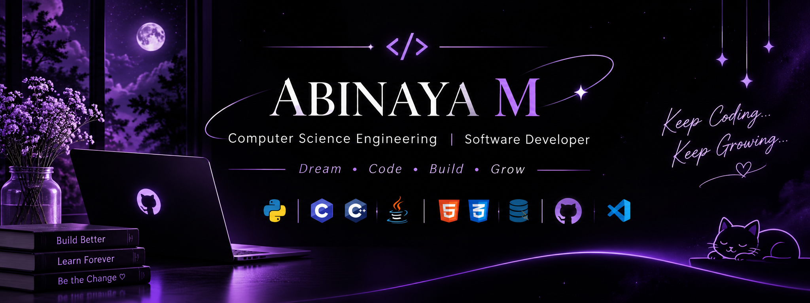

  

# Hey there! 👋 I'm Abinaya M

### Computer Science Engineering Student | Aspiring Software Developer

I’m a passionate CSE student interested in building practical software solutions and exploring modern technologies. I enjoy learning new concepts, solving problems, and turning ideas into meaningful projects.

---

### 👩‍💻 About Me

- 🎓 CSE Student at Dr. T. Thimmaiah Institute of Technology
- 💻 Interested in Software Development and Web Technologies
- 🌱 Currently improving my Java, DSA and problem-solving skills
- 🛠️ Building real-world academic and personal projects
- 🎯 Goal: Become a skilled software developer and contribute to impactful projects.

---

### ⚡ Technical Skills

**Programming Languages**

**Web & Database**

**Tools & Technologies**

---

### 🚀 Featured Projects

| Project | Description | Technologies |
|---|---|---|
| **Nexora AI** | AI-powered placement preparation platform for students | JavaScript, Node.js |
| **AI-Based Visual AirScript** | Converts hand movements in the air into digital text | Python, OpenCV, MediaPipe |
| **InventoryPro** | Inventory management system for managing products and stock | Python, Flask, MySQL |

---

### 🏆 Certifications

- NPTEL – Data Analytics with Python
- NPTEL – Problem Solving Through Programming in C
- Infosys Springboard – Java
- Cisco – Introduction to Networks
- Deloitte – Technology Job Simulation
- TCS Career Edge – Generative AI Essentials

---

### 📊 GitHub Statistics

---

### ✨ A Little More About Me

> "Learning continuously, building consistently, and growing with every challenge."

Thanks for visiting my profile! 😊

